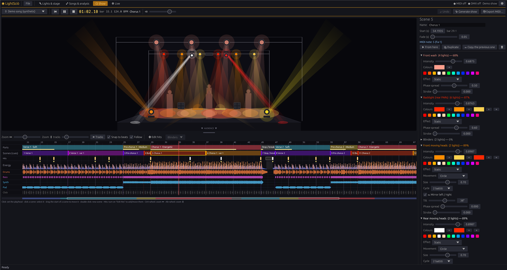

# LightSciò

**Build a custom light show from your band's multitrack backing tracks, preview it on your computer, and run it live — synced by MIDI from your backing-track player — through a cheap USB-DMX interface.**

LightSciò is a desktop app for Windows and macOS, written in Rust with [egui](https://github.com/emilk/egui). The interface is available in Italian and English.



---

## How it works

1. **Lights and stage** — pick your fixtures from a built-in set of generic profiles or from the QLC+ fixture library (search, favourites), or define custom fixtures channel by channel. Place them on a top-down stage plan (multi-selection, box selection, align / distribute / mirror), patch DMX addresses, and see the rig in a 2.5D view from the audience.
2. **Songs and analysis** — load the separate stems of each song (MP3, WAV, FLAC, OGG). LightSciò analyses them:
   - tempo and first downbeat (a click track, if present, gives the exact tempo);
   - song parts: intro, verse, pre-chorus, chorus, bridge, solo, breaks, ending;
   - intensity of every part, kick and snare hits, ensemble accents and sudden stops.
   
   The analysis editor shows the real waveforms of every track with a bar grid. You can drag the first downbeat, add extra downbeats where a bar is shorter, move part boundaries (they snap to bars), split and merge parts, and listen with a metronome click to check the grid.
3. **Show** — generate the show automatically with built-in rules, or optionally ask a locally installed [Claude Code](https://claude.com/claude-code) to design it. Everything stays editable on a timeline with scenes (colours, intensity, effects, moving-head movements with left/right mirroring, strobe) and hits (blinders, strobe bursts, white flashes, blackouts for stops). Preview it with the stems' audio.
4. **Export** — save a MIDI control track (`.mid`) per song and load it in your backing-track player next to the audio.
5. **Live** — the player sends MIDI to the computer; LightSciò listens and drives the lights through the DMX interface. In live use LightSciò does not play audio.

## MIDI mapping (live)

| Message | Action |
|---|---|
| Program Change *N* | select the song with programme number *N* |
| Note 0–119 | jump to scene *N* of the current song and run from there (resyncs the show) |
| Note 120 | start the current song from the beginning |
| Note 121 | stop |
| Note 122 | blackout on/off |
| MIDI Start / Continue / Stop | start from the top / resume / pause |
| Song Position Pointer | seek |
| CC 7 | master intensity |

The listening channel is configurable (default 16, or "all"). The exported `.mid` contains the Program Change, one note per scene, and an optional stop note at the end. The Live tab shows every message received.

## DMX output

- **Open DMX / FTDI** style USB dongles (the common low-cost ones), using serial break + 250 kbaud.
- **Enttec DMX USB Pro–compatible** interfaces.
- One universe (512 channels), 10–44 Hz refresh. A universe monitor and a test mode are included.
- The show is rendered in a background thread, so it keeps running when the window is minimised.

On Windows, FTDI-based dongles may need the FTDI VCP driver so they appear as a COM port.

## Other features

- **Adapt an existing show** (File menu): in a project with a different set of lights, import the songs and show of another project and choose, for each group of lights in this project, which group of the old show it takes its effects from. The other file is never modified.
- **Export / import lighting setup** (File menu, `.lucirig`): reuse stage and lights in another project. On import you can replace the current lights or add to them; a `.luci` show can be used as the source too.
- **Languages:** Italian and English (*Preferences → Language*; *Automatic* follows the system language).
- Lanes can be resized and hidden; the layout is saved with the project.
- **Preferences:** text size and button size.
- **Undo:** Ctrl+Z.

## Keyboard

| Key | Action |
|---|---|
| Space | play / pause (Show and analysis editor) |
| Ctrl/Cmd + Z | undo |
| Delete | delete the selected scene (or hit, when *hit editing* is on) |
| Ctrl + mouse wheel | horizontal zoom |
| Alt + mouse wheel | track height |

## Installing

Download the latest version from the [Releases page](https://github.com/thomasborgogno/LightScio/releases/latest):

- **Windows:** `LightScio-Setup-<version>.exe`. It installs per user (no administrator rights needed), adds a Start-menu entry, can create a desktop shortcut, and can open `.luci` show files by double click.
- **macOS:** `LightScio-<version>-macOS.dmg`. Open it and drag **LightScio** into **Applications**. It is a universal build for Apple Silicon and Intel, macOS 11 or later.

The installers are not signed with a paid certificate:

- **Windows:** SmartScreen may warn the first time; choose *More info → Run anyway*.
- **macOS:** right-click the app and choose *Open* the first time.

## Updates

At start-up (at most every 12 hours) LightSciò checks the latest GitHub release of the project. If there is a newer version, a banner offers to:

- download and install it — on Windows the installer runs silently and the app restarts by itself; on macOS the disk image opens so you can replace the app;
- show the release notes;
- remind you later, or skip that version.

The check can be turned off, or run by hand, in *File → Preferenze* (also *File → Controlla aggiornamenti*). The repository to check is configurable there; the default is `thomasborgogno/LightScio`. Nothing is sent except a plain request to the public GitHub API.

## Releasing a new version

The version number comes from the git tag:

```sh
git tag v1.0.0
git push origin v1.0.0
```

The GitHub Actions workflow in `.github/workflows/release.yml` builds the Windows installer (Inno Setup) and the macOS disk image, then publishes both in a GitHub release named after the tag. Running apps will offer the update automatically.

The workflow expects this folder (with `Cargo.toml`) to be the root of the repository.

Local builds of the installers:

- **Windows:** `installer\windows\build-installer.ps1` (needs [Inno Setup 6](https://jrsoftware.org/isinfo.php): `winget install JRSoftware.InnoSetup`).
- **macOS:** `bash installer/macos/build-dmg.sh`.

Both use `LIGHTSCIO_VERSION` if set, otherwise the latest git tag, otherwise the version in `Cargo.toml`.

## Building

Requirements: a recent stable [Rust](https://rustup.rs) toolchain.

```sh
cargo build --release
```

The executable is `target/release/lightscio` (`lightscio.exe` on Windows).

Command-line options:

- `--screenshot <file.png>` — start, render about 120 frames, save a picture of the window and exit (used for automated checks).
- `--dump-demo` — print the analysis of the built-in synthetic demo song.
- `--test-qlc` — parse every QLC+ fixture found and print a summary.
- `--version` — print the version.
- `--check-update [owner/repo]` — check GitHub for a newer release and print the result.
- `<file.luci>` — open that show (used by the Windows file association).

## Files

- `.luci` — a show/project: rig, songs (paths to the stems, analysis, parts, scenes, hits), settings and view layout. The audio itself is not stored, only the paths to the stems.
- `.lucirig` — a lighting setup (stage, fixtures, custom fixture profiles).
- `.mid` — the MIDI control track for the backing-track player.

## Fixture library: credits

The fixture library comes from **[QLC+](https://www.qlcplus.org)** (Q Light Controller Plus) and its contributors. QLC+ and its fixture definitions are released under the Apache License 2.0.

LightSciò does **not** bundle the QLC+ fixtures: it reads the `.qxf` files from a QLC+ installation or a QLC+ source folder on your computer, chosen in the catalog panel. A fixture you add to a show is copied into the project file. Many thanks to the QLC+ team and to everyone who contributed fixture definitions.

The built-in generic profiles are approximations of common channel layouts; always check them against your fixture's manual.

## Other open-source components

[egui / eframe](https://github.com/emilk/egui), [symphonia](https://github.com/pdeljanov/Symphonia), [cpal](https://github.com/RustAudio/cpal), [midir](https://github.com/Boddlnagg/midir), [serialport-rs](https://github.com/serialport/serialport-rs), [RustFFT](https://github.com/ejmahler/RustFFT), [ureq](https://github.com/algesten/ureq), [sys-locale](https://github.com/1Password/sys-locale), [roxmltree](https://github.com/RazrFalcon/roxmltree), [rfd](https://github.com/PolyMeilex/rfd), [serde](https://serde.rs), [image](https://github.com/image-rs/image). Each is under its own license (MIT and/or Apache-2.0). The Windows installer is built with [Inno Setup](https://jrsoftware.org/isinfo.php).

## Limitations

- One tempo per song. Extra downbeats can shorten bars, but there are no tempo changes.
- One DMX universe; no network DMX (Art-Net / sACN).
- 2.5D preview, not full 3D.
- Generic fixture profiles and the automatic analysis are estimates: check them before a gig.

## License

MIT — see [LICENSE](LICENSE).
